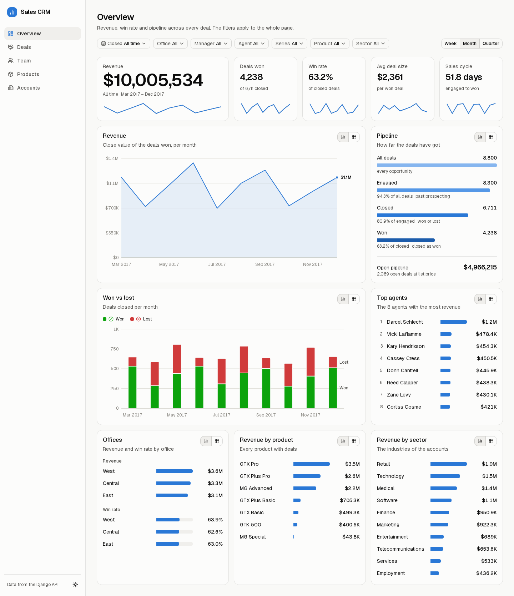
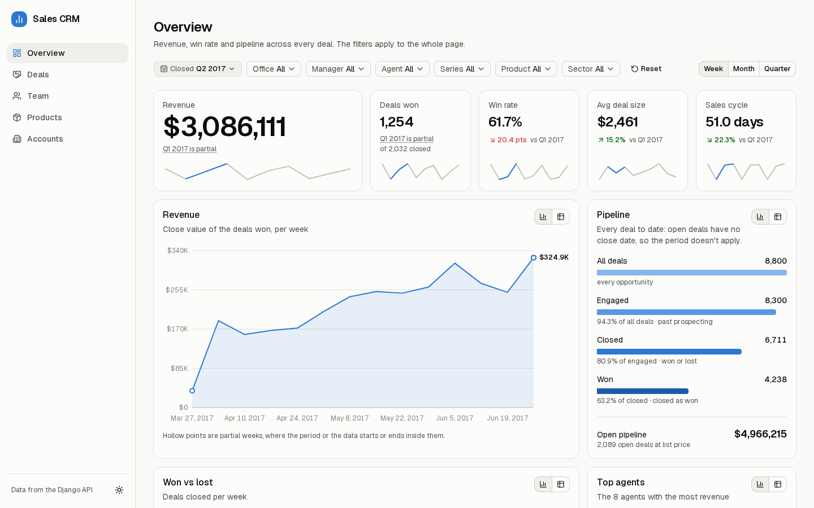
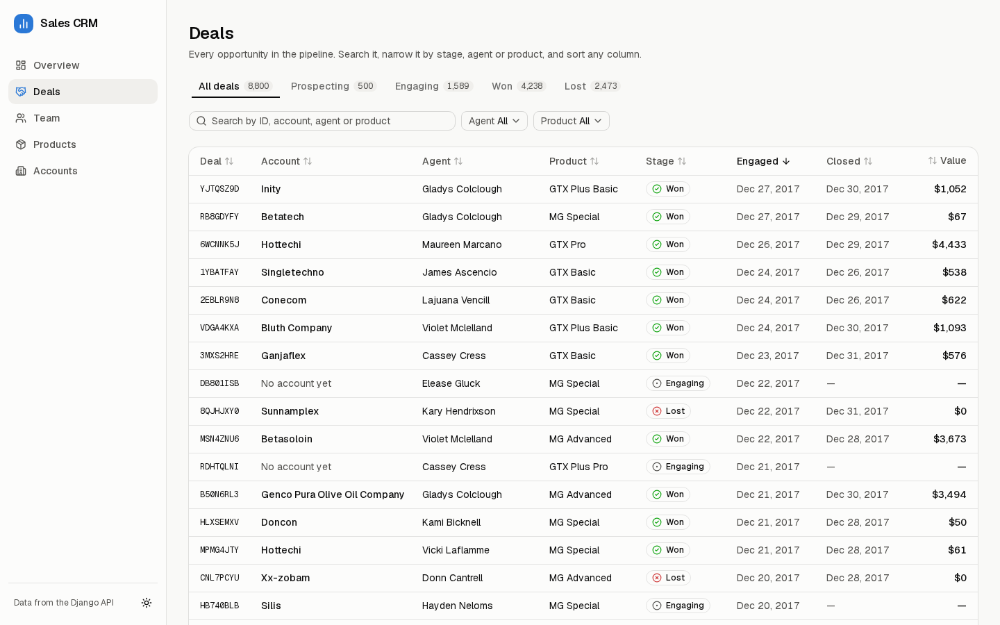
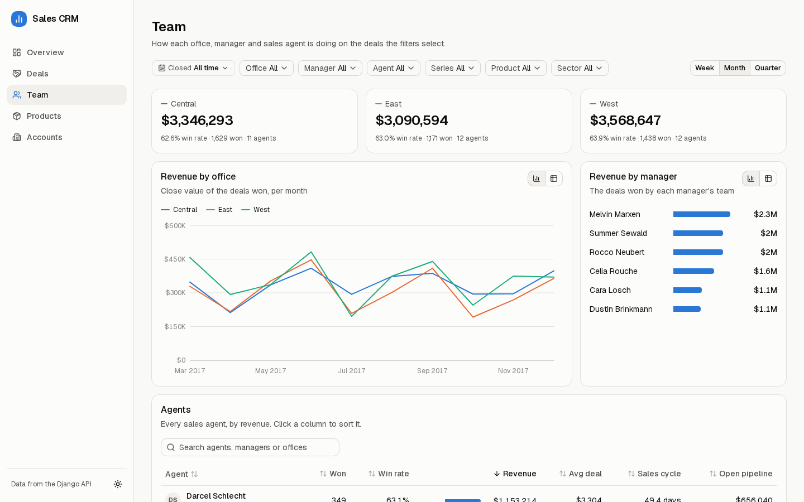
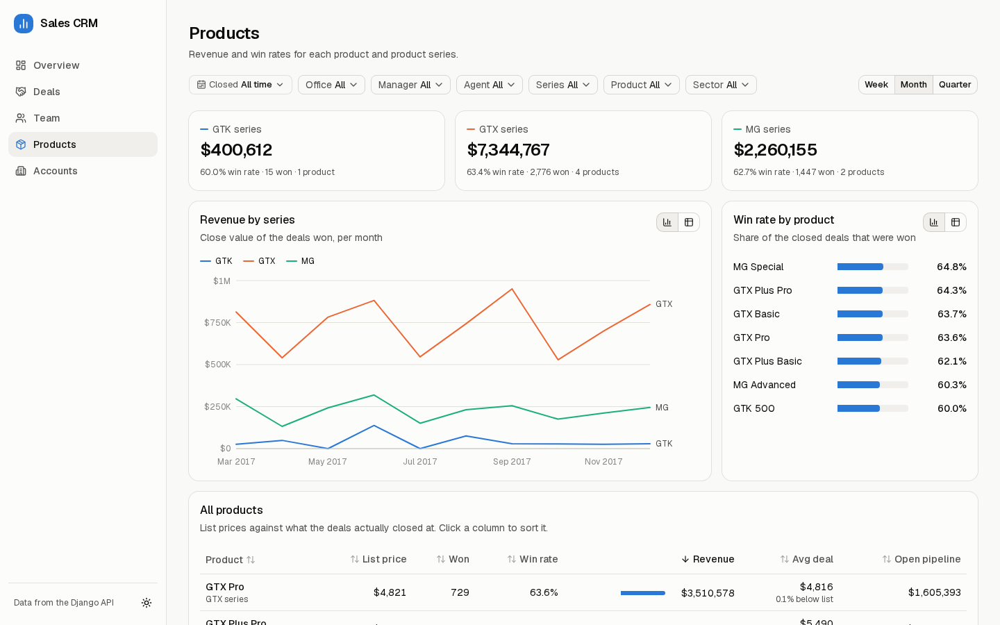
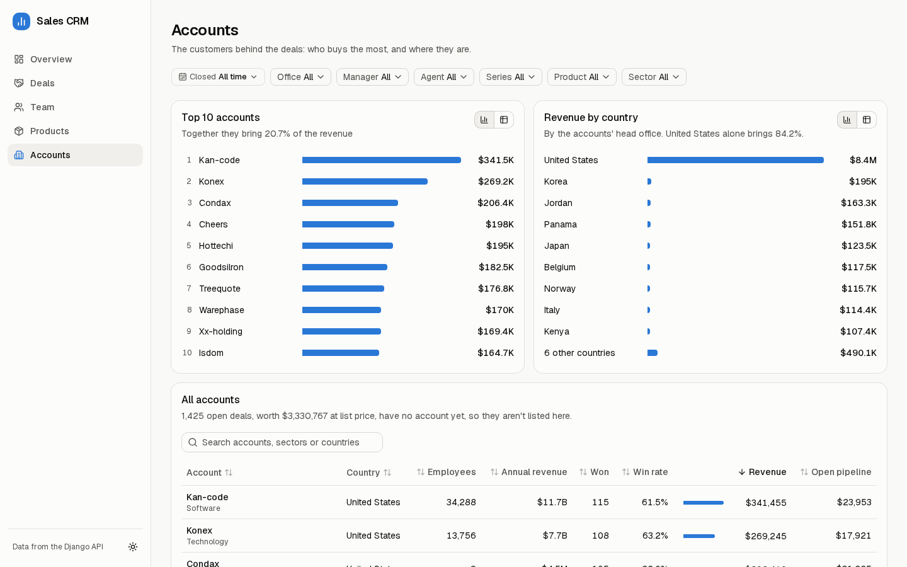
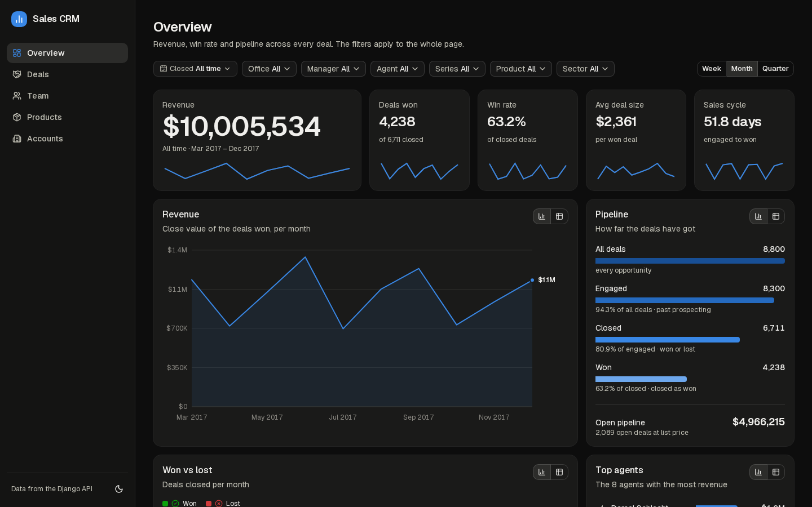
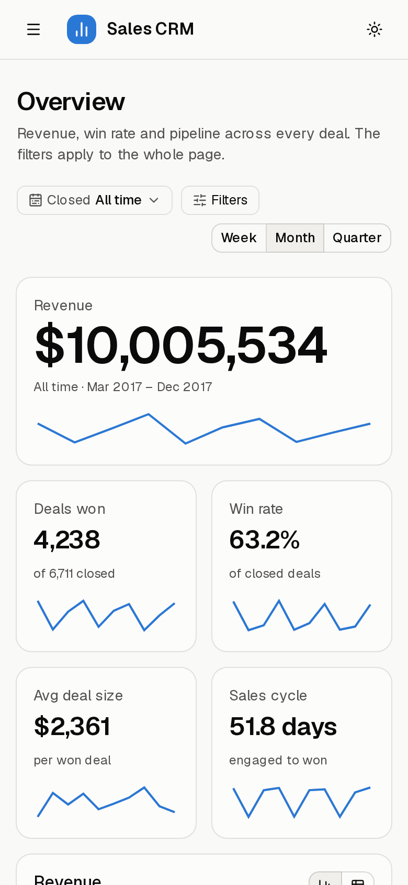

# Sales CRM

A sales dashboard built on a Django API and MongoDB.



| Folder    | What it is                                                                  |
| --------- | --------------------------------------------------------------------------- |
| `api/`    | Django REST API over MongoDB, the CSV import script and the source CSVs       |
| `client/` | Next.js dashboard with the charts and tables (see `client/README.md`)         |

## Screenshots

**Comparing periods.** Pick a quarter or a custom range and each figure shows its change
against the period before. Weeks or months only partly inside the range are marked.



| Deals | Team |
| ----- | ---- |
|  |  |
| **Products** | **Accounts** |
|  |  |

| Dark mode | On a phone |
| --------- | ---------- |
|  |  |

## Run it with Docker

You need Docker with Compose. From this folder:

```bash
docker compose up --build
```

The first run takes a few minutes to build the images. When the logs settle, open:

| What           | Where                           |
| -------------- | ------------------------------- |
| Dashboard      | http://localhost:3000           |
| API            | http://localhost:8000/api/      |
| API docs       | http://localhost:8000/api/docs/ |

Compose starts three containers:

- **mongo**: MongoDB 8. Its data is kept in the `mongo-data` volume between runs.
- **api**: the Django API. On every start it loads `api/data/*.csv` into MongoDB. The
  import writes only new or changed rows, so restarting never duplicates anything.
- **client**: the Next.js dashboard, which calls the API from its server.

### Everyday commands

```bash
docker compose up -d --build     # run in the background
docker compose logs -f api       # follow the logs of one container
docker compose down              # stop everything and keep the data
docker compose down -v           # stop everything and delete the data
docker compose exec mongo mongosh crm    # open a MongoDB shell
```

After changing code, run `docker compose up --build` again to rebuild the images.
The containers don't pick up edits on their own: for live reloading, run the app
without Docker (below).

### Use MongoDB Atlas instead of the local database

Copy `.env.example` to `.env` in this folder, uncomment the Atlas lines and fill them in:

```bash
MONGODB_URI=mongodb+srv://<db_username>:<db_password>@<your-cluster>.mongodb.net/
MONGODB_PASSWORD=your-database-user-password
SEED_DATA=false
```

Keep the literal `<db_password>` in the URI: the API fills it in from `MONGODB_PASSWORD`.
Leave out `SEED_DATA=false` only if you want the CSVs imported into Atlas on every start.
The local `mongo` container still starts, but nothing uses it.

Atlas must allow your current IP address (Atlas > Security > Network Access). If it
doesn't, `docker compose logs api` shows `SSL handshake failed`. The same applies when
you run the API without Docker, and your IP address can change over time.

### If something goes wrong

- **Port 3000 or 8000 is already in use.** Stop whatever is using it, such as the
  development servers below, or change the left-hand port under `ports:` in `compose.yaml`.
- **The dashboard says it couldn't load its data.** Run `docker compose logs api`. The
  import prints its errors there.

The ports are published on `127.0.0.1` only, so nothing is reachable from other
machines. This setup is for running on your own computer. Before deploying it to a
server you would need HTTPS, your own `DJANGO_SECRET_KEY`, and a MongoDB with a login.

## Run it without Docker

For development with live reloading. The API needs Python 3.13 and uses `api/.env`
for its database settings (see `api/.env.example`):

```bash
cd api
python3 -m venv venv
source venv/bin/activate
pip install -r requirements.txt
python manage.py import_data     # load the CSVs into MongoDB
python manage.py runserver       # http://127.0.0.1:8000
```

The dashboard needs Node.js 24. In another terminal:

```bash
cd client
npm install
npm run dev                      # http://localhost:3000
```
